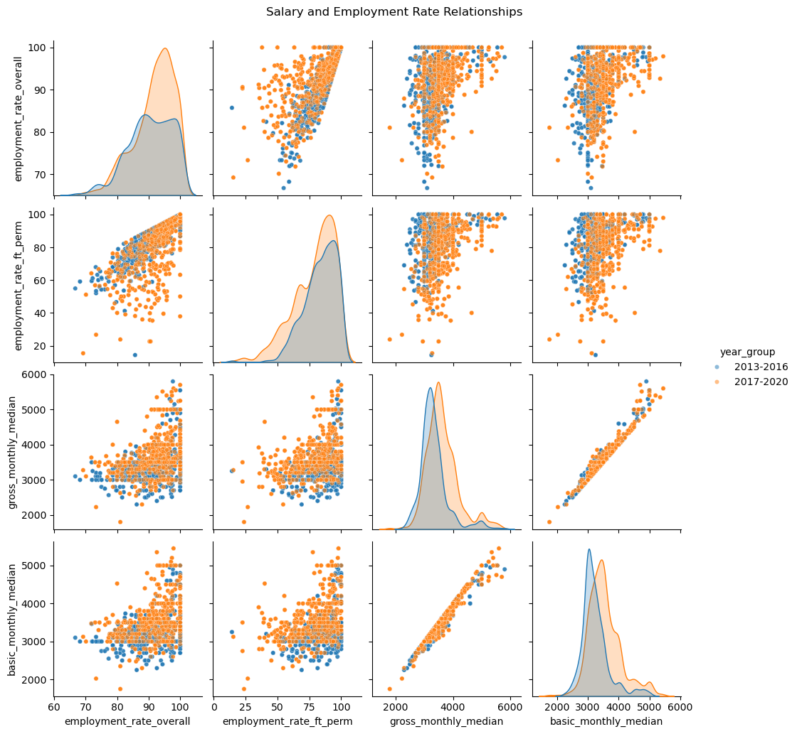
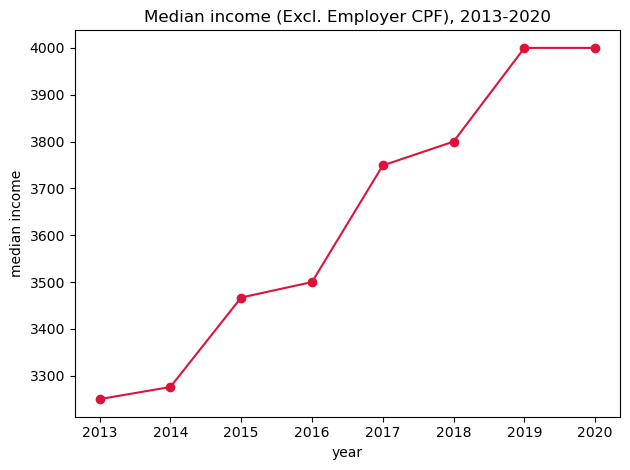
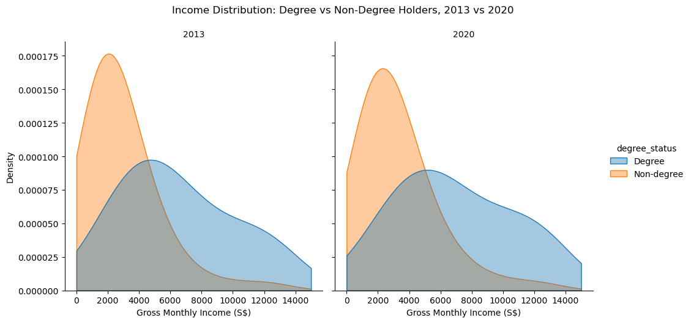
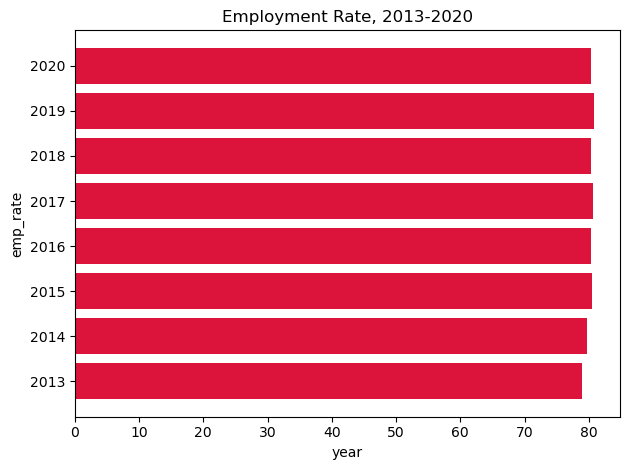

# Does a University Degree Still Pay Off in Singapore?

A group data analysis project for **Programming for Data Analysis (CA2)** at Singapore Polytechnic. We compared graduate employment survey data with national workforce data to see how a degree affects salary and employment stability from 2013 to 2020.

> Group project with 3 teammates. My part: merging and cleaning the datasets, the KDE graph, and the UiPath workflow (AI analysis function).

## Research question
How does holding a university degree affect salary and employment stability in Singapore?

## Charts and findings

### Salary and employment relationships
A pairplot comparing employment rates and salary measures for 2013–2016 and 2017–2020. Gross and basic monthly median salary move almost in a straight line together, and salaries in the later period shift higher.

### Median income rose steadily
National median income (excluding employer CPF) climbed from about $3,250 in 2013 to $4,000 by 2019, then held steady in 2020.

### Degree holders earn more
In both 2013 and 2020, the income distribution for degree holders sits further right than for non-degree holders, meaning higher incomes.

### Employment stayed stable
Employment rate stayed at roughly 80% every year, so the income gains did not come with a drop in employment.

## Data
All datasets come from [data.gov.sg](https://data.gov.sg), including Ministry of Manpower (MOM) employment and income statistics.

## What I did
- Loaded, cleaned and merged several datasets with pandas
- Converted income brackets into numeric midpoints for analysis
- Built a pairplot, line chart, bar charts and density plots, each with written analysis tied to the research question

## Tools
Python · pandas · matplotlib · seaborn · Jupyter Notebook

## How to run
1. `pip install pandas matplotlib seaborn jupyter`
2. Keep the notebook and the `CA2 Datasets` folder together
3. Open `PDAS_CA2.ipynb` and run all cells

## Presentation and demo
Slides and the UiPath automation video are on my portfolio website: <!-- EDIT: paste your site link -->
